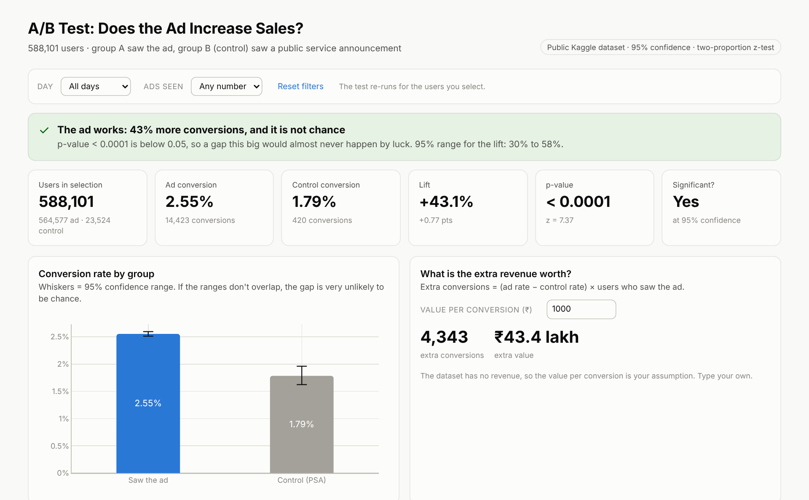
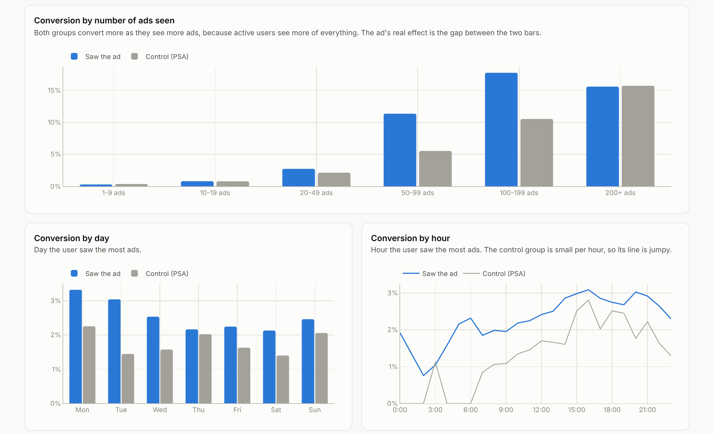
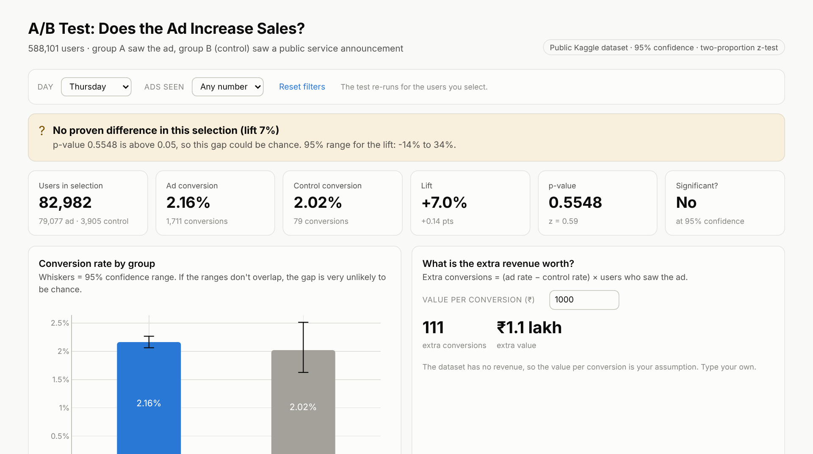

# A/B Test Analysis: Does the Ad Increase Sales?

A company showed an advert to most users and a public service announcement (PSA) to a small control group. This project uses **588,101 users** to test whether the ad really increases conversions, by how much, whether the result could be luck, and where the ad works best.

**Tools:** Python (Pandas, SciPy, NumPy) · SQL (SQLite) · Plotly · Excel

### [▶ Open the live interactive dashboard](https://ayush-rag.github.io/ab-test-ad-campaign-analysis/)



---

## The answer

**Launch the ad.** Users who saw the ad converted **43% more** than the control group, and the result is statistically significant (p < 0.0001).

| | Saw the ad | Control (PSA) |
|---|---:|---:|
| Users | 564,577 | 23,524 |
| Conversions | 14,423 | 420 |
| Conversion rate | **2.55%** | **1.79%** |
| 95% confidence range | 2.51% - 2.60% | 1.62% - 1.96% |

| Test result | Value |
|---|---|
| Relative lift | **+43.1%** (95% range +30.0% to +57.5%) |
| Absolute lift | +0.77 percentage points (95% range +0.60 to +0.94) |
| Two-proportion z-test | z = 7.37, **p = 1.7 × 10⁻¹³** |
| Chi-square test (cross-check) | χ² = 54.3, p = 1.7 × 10⁻¹³ |
| Bootstrap, 20,000 runs (cross-check) | lift +30.4% to +57.9% |
| Smallest lift this test could detect (80% power) | 13.8% |
| Without the top 0.1% heaviest users | lift +42.8%, p = 2.7 × 10⁻¹³ (unchanged) |
| Extra conversions caused by the ad | **about 4,343** |
| Extra value at ₹1,000 per conversion (assumption) | **about ₹43.4 lakh** |

## Insights

1. **The ad works, and it isn't luck.** The chance of seeing a gap this big if the ad did nothing is about 1 in 6 trillion.
2. **The test was big enough.** It could detect a lift as small as 13.8%; the real lift (43%) is three times that.
3. **The ad needs repetition.** For users who saw 1-19 ads, the ad and control groups convert the same. The gap appears from 20 ads and peaks at **50-99 ads (+105%)**. At 200+ ads there is no proven difference again.
4. **Careful with "more ads = more sales".** Conversion rises with ads seen in *both* groups (0.3% to about 16%), because active users simply see more of everything. Only the gap between the groups shows the ad's real effect.
5. **The day may matter.** The lift is biggest on Tuesday (+111%) and smallest on Thursday (+7%, not significant). Only Monday, Tuesday and Wednesday pass the stricter per-segment test, so day targeting is a lead to test, not a proven fact.



## Recommendations

| Recommendation | Why |
|---|---|
| **Launch the campaign to everyone** | +43% conversions, statistically significant, about 4,300 extra conversions |
| **Run a follow-up test on ad frequency** | The effect appears only after about 20 views. Testing frequency caps could find the most cost-effective number of impressions |
| **Test early-week targeting** | Monday to Wednesday show the strongest proven lift |
| **Keep a small control group running** | The 4% holdout made this measurement possible. Keep it to track whether the effect lasts |

---

## How it works

```
Raw data: 588,101 users (one row each)
        │  src/clean_data.py      checks: missing values, duplicate users,
        ▼                         valid groups/days/hours, extreme values
Clean data                        → data/processed/
        │  src/load_database.py
        ▼
SQL database (ab_test table with CHECK constraints)
        │  src/run_analysis.py + src/stats_tests.py
        ▼
5 SQL queries + z-test, chi-square, confidence intervals,
bootstrap, power, segment tests   → outputs/ (CSVs, Excel, insights)
        │  src/build_dashboard.py
        ▼
Interactive dashboard             → docs/index.html (GitHub Pages)
```

### 1. Data
The public **"Marketing A/B Testing"** dataset ([Kaggle](https://www.kaggle.com/datasets/faviovaz/marketing-ab-testing)). The copy in `data/raw/` comes from the [uplift_sklearn_data release](https://github.com/jszymon/uplift_sklearn_data/releases/tag/marketing_AB). One row per user:

| Column | Meaning |
|---|---|
| `user_id` | Unique user |
| `test_group` | `ad` = saw the advert, `psa` = saw a public service announcement (control) |
| `converted` | 1 = bought, 0 = didn't |
| `total_ads` | Number of ads the user saw |
| `most_ads_day` / `most_ads_hour` | When the user saw the most ads |

### 2. Data checks
Before trusting a test, the data has to be clean. Every check is logged in `outputs/cleaning_log.csv`:

| Check | Rows failing |
|---|---:|
| Missing values | 0 |
| Same user appearing twice (could be in both groups) | 0 |
| Unknown test group | 0 |
| Invalid day, hour (0-23) or ad count | 0 |
| Extreme ad counts (top 0.1%, kept and re-tested without them) | 589 |

The data passed every check. The script also accepts the original Kaggle file (extra index column, column names with spaces, True/False values) and standardises it.

The groups are 96% / 4%. That's a deliberate small holdout, common in ad testing because it wastes little ad reach. The tests used here handle unequal group sizes.

### 3. The statistics (`src/stats_tests.py`)

| Method | Question it answers |
|---|---|
| Two-proportion **z-test** | Is the gap between the two conversion rates bigger than chance? |
| **Chi-square** test | The same question asked a second way, as a check |
| **Wilson** confidence interval | What range is each group's true conversion rate likely in? |
| Log-ratio interval + **bootstrap** | What range is the true lift likely in? |
| **Power** / minimum detectable effect | Was the test big enough to find a real effect? |
| **Bonferroni** correction | When testing 7 days and 6 ad buckets, how do we avoid false alarms? |

Decision rules were fixed before looking at results: 5% significance level (95% confidence), 80% power.

### 4. SQL (`sql/`)
One table with `CHECK` constraints that guard data quality. The queries use `GROUP BY`, conditional aggregation (`SUM(CASE WHEN …)`) to put both groups side by side, CTEs, and window functions.

### 5. Dashboard
`docs/index.html` is a single interactive page. Choose a **day** or a **number of ads seen**, and it **re-runs the z-test live** for those users. The verdict, p-value and confidence range update instantly, using the same maths as the Python code (cross-checked: Thursday gives p = 0.5548 in both). It also has a calculator for the value of the extra conversions.



### 6. Excel report
`outputs/ab_test_report.xlsx`: test result, group summary, tested segments by day and ad count, hourly data, insights.

---

## Project structure

```
ab-test-ad-campaign-analysis/
├── main.py                        # runs the full pipeline
├── requirements.txt
├── src/
│   ├── config.py                  # paths, significance level, value per conversion
│   ├── clean_data.py              # 1. data checks
│   ├── load_database.py           # 2. load into SQLite
│   ├── stats_tests.py             # the statistics (z-test, CIs, power…)
│   ├── run_analysis.py            # 3. SQL + tests + insights + Excel
│   ├── build_dashboard.py         # 4. HTML dashboard
│   └── dashboard_template.html
├── sql/
│   ├── 01_create_tables.sql
│   └── 02_ab_queries.sql
├── data/
│   ├── raw/marketing_AB.csv.gz
│   └── processed/ab_test_clean.csv.gz
├── outputs/
│   ├── test_result.csv            # every number of the main test
│   ├── test_summary.json
│   ├── segment_tests_by_day.csv
│   ├── segment_tests_by_ads_seen.csv
│   ├── ab_test_report.xlsx
│   ├── insights.md
│   ├── cleaning_log.csv
│   └── sql_results/
├── docs/index.html                # interactive dashboard (GitHub Pages)
└── images/                        # screenshots
```

## How to run

```bash
git clone https://github.com/Ayush-rag/ab-test-ad-campaign-analysis.git
cd ab-test-ad-campaign-analysis
pip install -r requirements.txt
python main.py
```

The pipeline takes about 10 seconds. Then open `docs/index.html`. To change the assumed value per conversion or the significance level, edit `src/config.py`.

## Skills demonstrated

- **Experiment analysis:** hypothesis testing, confidence intervals, statistical power, multiple-testing correction
- **Statistics in Python:** SciPy, bootstrap simulation, cross-checking one method with another
- **Data validation:** checking an experiment's data before trusting its result
- **SQL:** constraints, conditional aggregation, CTEs, window functions
- **Critical thinking:** separating correlation (more ads seen) from the ad's causal effect (the gap between groups)
- **Communication:** a dashboard that explains the result in plain words and lets people test segments themselves

---

**Ayush Raghav** · B.Tech CSE, Manipal University Jaipur · ayushraghav.work@gmail.com
